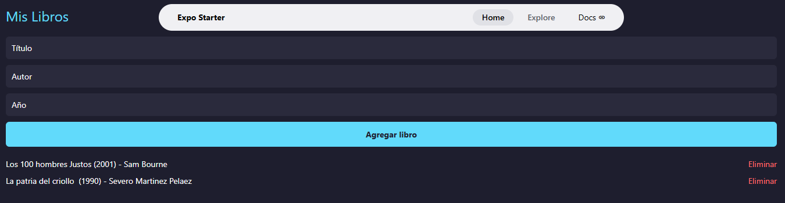

# Welcome to your Expo app 👋

# Mis Libros

Aplicación en React Native + TypeScript para agregar, listar y eliminar libros.

## Reflexión

**¿Por qué es conveniente separar la lógica de los libros de App.tsx?**
Se hace para tener una mejor estructura y hacer el codigo mas manejable, ya que al hacer cambios la logica no afecta a interfaz de la pantalla y previene trabajo adicional o errores en la interfaz

**¿Qué responsabilidad tiene LibroService?**
Guardar la lista de libros y ofrecer las operaciones sobre ella (agregar, eliminar, obtener).

**¿Qué responsabilidad tiene la clase Libro?**
Representar los datos y el comportamiento de un solo libro.

## Captura de la aplicación

