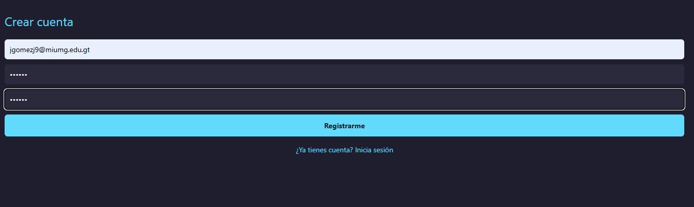
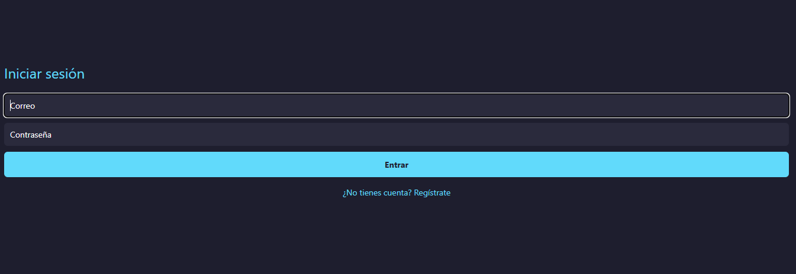
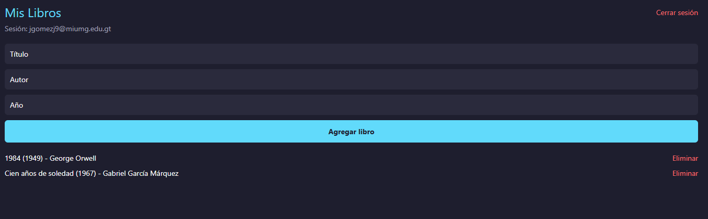
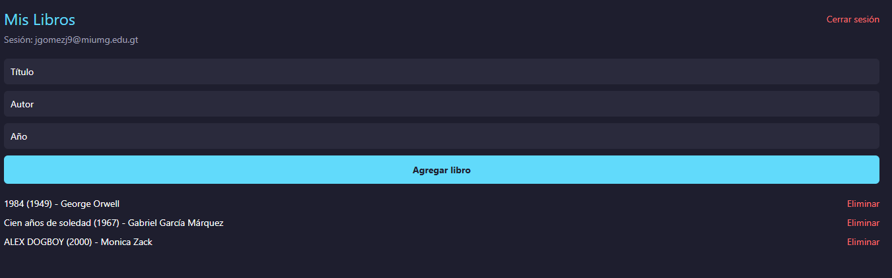

## Supabase y Autenticación

Los libros ahora se almacenan en una tabla `libros` en Supabase (id, titulo,
autor, anio). `LibroRepository` (Singleton) obtiene, agrega y elimina libros en
Supabase; `LibroService` delega en él. `AuthService` encapsula el registro, el
inicio y el cierre de sesión con Supabase Auth. La navegación depende de la
sesión: sin sesión solo existen las pantallas de Login/Registro, y con sesión
solo existe Home.

### Configuración

1. Crear un proyecto en Supabase y ejecutar `supabase/setup.sql` en el SQL Editor.
2. Copiar `.env.example` a `.env` y completar la URL y la clave publicable.
3. `npm install` y `npm run web`.

### ¿Cómo se relaciona la autenticación con el acceso a los datos?

(Explícalo con tus palabras. Ideas: la autenticación responde "¿quién eres?";
al iniciar sesión, cada petición a Supabase viaja con un token y la base de
datos la trata como el rol `authenticated`; sin sesión es el rol `anon`.
GRANT decide qué operaciones puede hacer un rol sobre la tabla (aquí solo
`authenticated` tiene select, insert y delete). RLS decide sobre qué filas
puede actuar; las políticas que creé permiten consultar, agregar y eliminar
a los usuarios autenticados. Sin GRANT la consulta falla por permisos; sin
política RLS la tabla parece vacía o no se elimina nada; sin sesión no se
accede a los libros.)

### Capturas

**Registro**

**Login**

**Libros almacenados en Supabase**

**Cierre de sesión**

